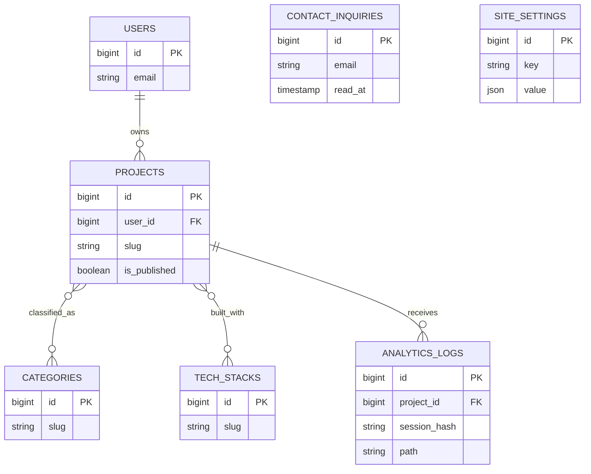

# ApekTech portfolio architecture

## Domain model

The migration `2026_09_15_000001_create_portfolio_tables` creates indexed, foreign-keyed tables for the portfolio, inquiries, settings, and privacy-focused analytics. Project categories and tech stacks use composite-key pivot tables; project content uses JSON columns for flexible screenshots, features, and outcomes.

## Request flow

- Public pages use `PublicSiteController` and Inertia props; category filters are query parameters and preserve the page scroll position.
- Contact submissions use `StoreContactInquiryRequest`, CSRF-protected Laravel web middleware, and a named five-per-minute IP throttle.
- `TrackAnalytics` records only Inertia GET visits, storing a one-way session hash rather than raw IP addresses or user agents.
- Authenticated users receive the dashboard through `AdminDashboardController`; inquiry read state is updated with a protected PATCH route.

## Production hardening

- Public work is available at `/projects`; blog posts are managed by superadmins at `/admin/blog`, with visual authoring, draft and scheduled publication, categories, tags, SEO metadata, and cover images. Anonymous blog comments are rate-limited and remain private until approved in `/admin/blog-comments`.
- Run behind TLS, set `SESSION_SECURE_COOKIE=true`, use a database or Redis session driver, and configure a trusted proxy.
- Send HSTS (`max-age=63072000; includeSubDomains; preload`), `X-Content-Type-Options: nosniff`, `X-Frame-Options: SAMEORIGIN`, and `X-XSS-Protection: 1; mode=block` on responses. Laravel applies these to application responses; Apache's `mod_headers` configuration in `public/.htaccess` also covers static files. Ensure any CDN or alternate web server sends the same headers.
- The HSTS `preload` directive opts in to preload eligibility but does not add the domain to browser preload lists. After confirming the apex domain and all subdomains are HTTPS-only, submit the domain at [hstspreload.org](https://hstspreload.org/). Preloading is difficult to reverse and can take time to be removed from browser releases.
- Set `APP_DEBUG=false`, rotate `APP_KEY` only during a planned credential migration, and keep `.env` outside the web root.
- Use `php artisan migrate --force`, `php artisan config:cache`, `php artisan route:cache`, and `php artisan view:cache` during deployment.
- Build with `npm run build`; serve `public/build` with immutable cache headers and use a CDN for uploaded WebP media.
- Keep contact throttling enabled and add an edge WAF/rate limit for high-volume deployments.
- Schedule pruning for old analytics records and restrict CMS routes with role/permission middleware when multiple staff accounts are introduced.